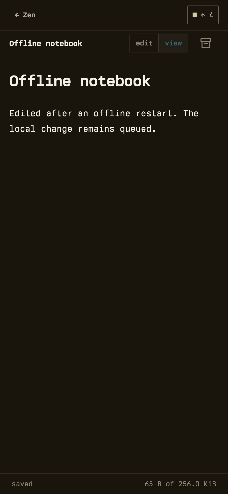

# Offline installed app recovery (#225)

Verified 2026-11-19 with a production Vite build served at
`http://127.0.0.1:4173`, headed Chrome through `chrome-devtools`, and an isolated
browser context. This evidence contains only a synthetic local library; no
GitHub token, assistant credential, or private repository was configured.

## Reproduction before the fix

1. Open `/app/` online, wait for an activated `/app/` service-worker registration
   and the `research-pocket-shell-v5-root` cache, and create a local library.
2. Set network conditions to Offline and reload. The empty library shell renders.
3. Save `https://example.com/offline-pwa-check`, titled `Offline PWA regression`.
4. The mutation fails with **The private library worker stopped before its
   operation completed.** Network evidence shows
   `/assets/domain.worker-DwQqcD6Q.js` failing with `net::ERR_ABORTED`.
   CacheStorage already contains the worker bytes: scope, rather than a missing
   file alone, prevents interception.

## Verification after the fix

- Reopen online in the same browser context. The new root registration activates
  and the previous `/app/` registration retires; the local library is retained.
- Disable the network and reload before any domain mutation in that page.
  Saving the same test URL succeeds and produces one pending immutable update.
  The domain worker and its WASM both return 200 while network conditions are
  Offline.
- Create `Offline notebook` and edit its body offline. Reload, reopen the
  document, and edit again. Four pending changes remain durable.
- Install the final build with its manifest-derived cache revision. An online
  update removes the earlier shell cache and leaves one root registration.
- Open a blank tab in the same isolated context, close both existing app tabs,
  set the new tab to Offline at a 390 × 844 mobile/touch viewport, and navigate
  to `/ResearchPocket/app/?launch=homescreen#document=<test-document-id>`.
  It redirects to `/app/` while preserving the query and document fragment.
  The saved body **Edited after an offline restart. The local change remains
  queued.** renders with four pending changes.
- Reconnect and reload. The same body and four pending changes remain. No remote
  synchronization is claimed: this test has no configured repository or token.
- Inspect CacheStorage: only the asset manifest, canonical owner HTML, owner
  scripts/styles/fonts, favicon, web manifest, domain worker, and WASM are
  present. No launch query, document body, public docs HTML, or API response is
  stored there.

## Automated verification

- `bun install --frozen-lockfile`
- `bun run verify`: all 40 existing web contracts, Rust/WASM production build,
  TypeScript, design policy, Vite build, artifact checks, and the strengthened
  offline shell contract pass.
- `bun run check:offline`: nine representative shell resources, four installed
  launch routes, actual registration scope, and cache exclusions pass.
- Negative regression experiment: temporarily restoring `/app/` in the actual
  registration routine makes `check:offline` fail on the domain worker, WASM,
  and installed launch routes. Restoring the fix passes.
- `bun audit`: no vulnerabilities found.
- `git diff --check`: passes.

The existing Vite advisory about chunks larger than 500 KB remains.

## Physical iOS acceptance

Chrome mobile emulation does not run WebKit or create an iOS Home Screen app.
On a physical iPhone after deployment, open the existing installed app online
and let it finish loading, close it, enable airplane mode, and reopen it from
Home Screen. Verify an existing save and Zen document, make an edit, close and
reopen offline again, then reconnect and confirm the queued edit remains.
Do not clear website data or remove the installed app to perform this check.
